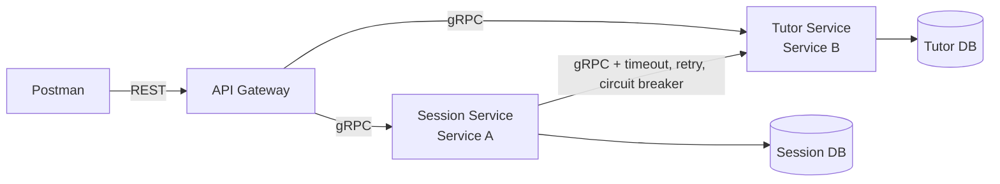

# Assignment 2: Two Collaborating Microservices

## Tutor Sessions: Two Collaborating Microservices

A small distributed application written in Go. Two microservices, each with its own database, are exposed to clients through a REST API Gateway.

- **Tutor Service (Service B):** owns the *Tutor* resource (independent).
- **Session Service (Service A):** owns the *Session* resource (a booked tutoring session, which depends on a tutor).

### Architecture



- Postman talks only to the gateway (REST). The gateway forwards to the services over gRPC.
- Session Service calls Tutor Service over gRPC to confirm a tutor exists before a session is created, and to fetch the tutor name when a session is retrieved.
- **Database per Service:** each service has its own PostgreSQL container. The Session DB stores only `tutor_id`; tutor data is read only through the Tutor Service gRPC API.

### Run the system

Requirements: Docker with Docker Compose. Run from this folder (`Assignment 2`):

```bash
docker compose up --build
```

The gateway is then available at `http://localhost:8080`. Check it with `curl localhost:8080/health`.
Stop with `Ctrl+C`; remove containers and data with `docker compose down -v`.

### REST API (via the gateway)

| Method | URL | Description | Success |
|---|---|---|---|
| POST | `/tutors` | Create a tutor | 201 |
| GET | `/tutors/{id}` | Get a tutor | 200 |
| PUT | `/tutors/{id}` | Update a tutor | 200 |
| DELETE | `/tutors/{id}` | Delete a tutor | 204 |
| POST | `/sessions` | Create a session (validates the tutor via Tutor Service) | 201 |
| GET | `/sessions/{id}` | Get a session (includes `tutor_name`) | 200 |
| PUT | `/sessions/{id}` | Update student, date, duration | 200 |
| DELETE | `/sessions/{id}` | Delete a session | 204 |
| GET | `/health` | Gateway health check | 200 |

Example bodies:

```json
POST /tutors   {"name":"Karma Dorji","email":"karma@example.com","subject":"Mathematics","hourly_rate":15}
POST /sessions {"tutor_id":"<tutor id>","student_name":"Pema Lhamo","session_date":"2026-10-20","duration_minutes":60}
```

### gRPC to HTTP error mapping

| gRPC code | HTTP status |
|---|---|
| InvalidArgument | 400 Bad Request |
| NotFound | 404 Not Found |
| AlreadyExists | 409 Conflict |
| Unavailable | 503 Service Unavailable |
| DeadlineExceeded | 504 Gateway Timeout |
| anything else | 500 Internal Server Error |

### Validation

- Tutor: `name` and `subject` required, `email` must be valid, `hourly_rate` > 0, `id` must be a UUID.
- Session: `tutor_id` and `id` must be UUIDs, `student_name` required, `session_date` must be `YYYY-MM-DD`, `duration_minutes` between 15 and 480.
- The gateway rejects malformed JSON and unknown fields with 400. Invalid requests are never stored.

### Resilience (Session Service -> Tutor Service)

| Pattern | Behaviour | Setting (default) |
|---|---|---|
| Timeout | Each call to Tutor Service is limited | `TUTOR_TIMEOUT_MS=2000` |
| Retry with backoff | Retries only on Unavailable/DeadlineExceeded; waits 100 ms, 200 ms... | `TUTOR_MAX_RETRIES=2` |
| Circuit breaker | Opens after consecutive failures, fails fast, then half-open trial | `CB_FAILURE_THRESHOLD=5`, `CB_OPEN_SECONDS=10` |

When the Tutor Service is stopped:
- `POST /sessions` returns **503** with a clear message (no hang, no crash).
- `GET /sessions/{id}` returns **200** with a **fallback** `tutor_name` ("unavailable (tutor service is down)").

Business errors (NotFound, InvalidArgument) are not retried and do not trip the breaker.

### Configuration

All configuration comes from environment variables, defined in `.env` and passed through `docker-compose.yml`: gateway/gRPC ports, database host/port/user/password/name for each service, service addresses, and the resilience settings above. Nothing is hard-coded.

### Project structure

proto/ tutor.proto, session.proto
gen/ generated Go code (protoc)
service-b/ Tutor service (main.go, store.go, server.go, Dockerfile)
service-a/ Session service (main.go, store.go, server.go, tutorclient.go, Dockerfile)
gateway/ REST API gateway (main.go, handlers.go, Dockerfile)
docker-compose.yml, .env
postman_collection.json


### Testing with Postman

Import `postman_collection.json`. `baseUrl` is `http://localhost:8080`. Run the requests in order; each has test scripts. The *Resilience* folder explains when to run `docker compose stop tutor-service` and `docker compose start tutor-service`.

### Regenerating protobuf code (optional)

```bash
protoc --proto_path=proto --go_out=. --go_opt=module=tutorsessions \
  --go-grpc_out=. --go-grpc_opt=module=tutorsessions proto/tutor.proto proto/session.proto
```
